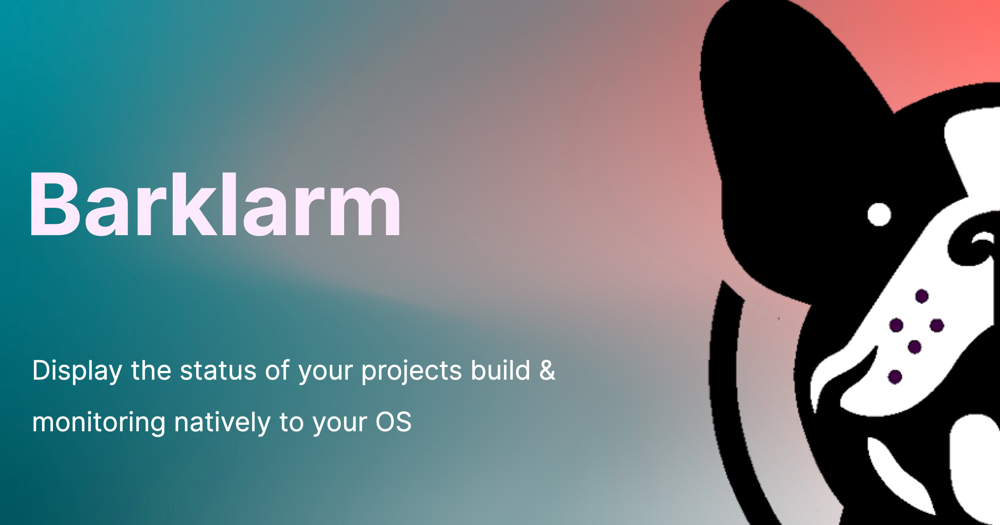
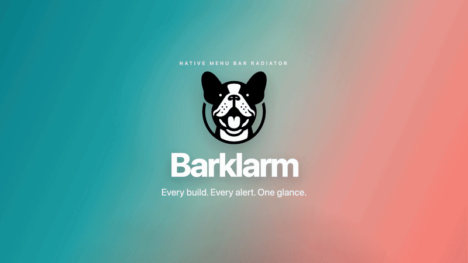
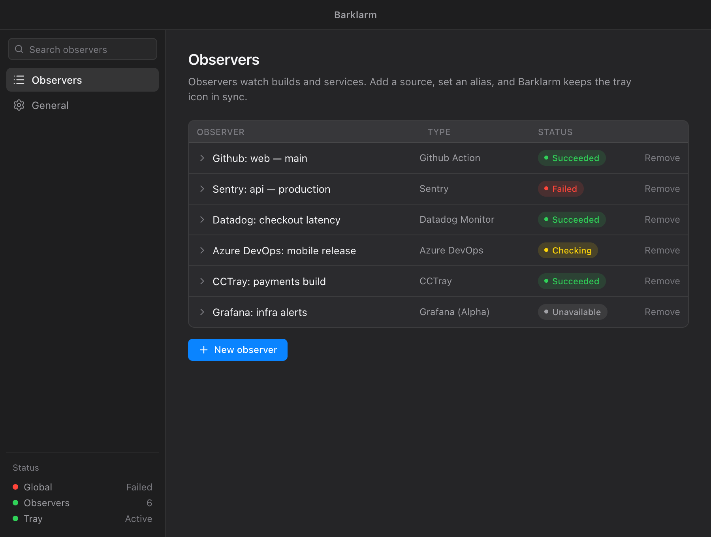
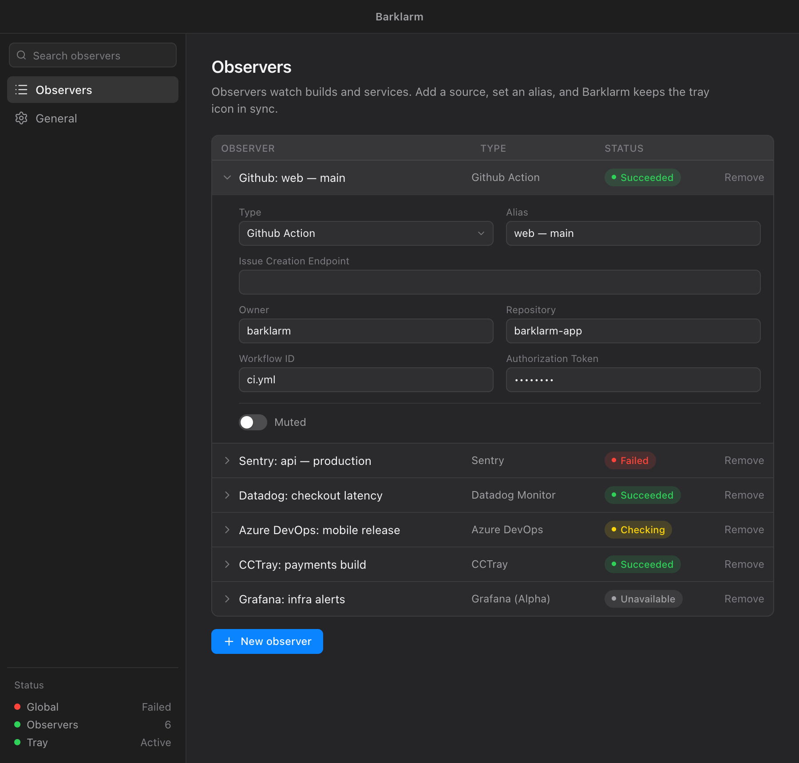
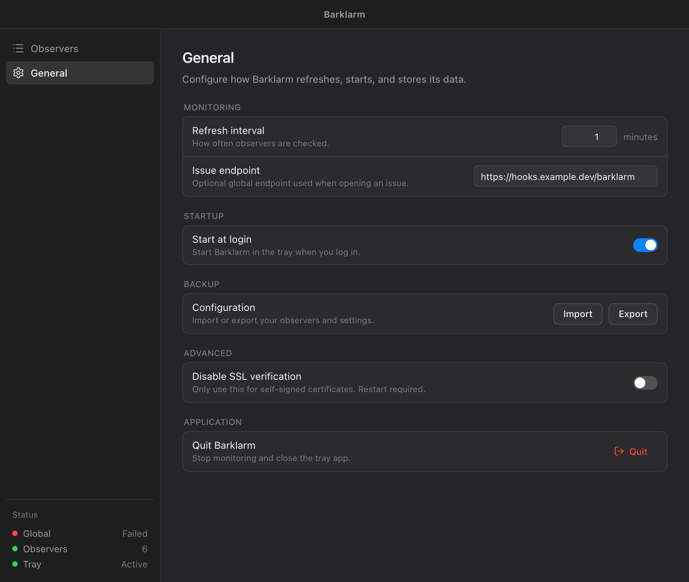
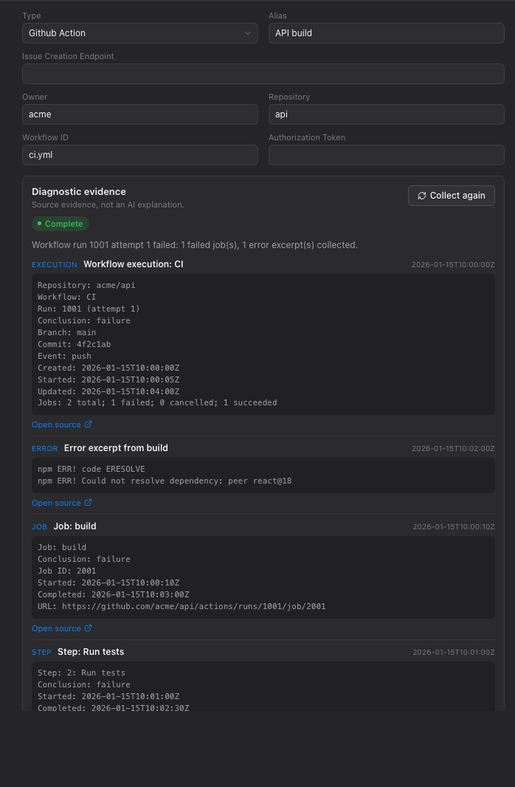
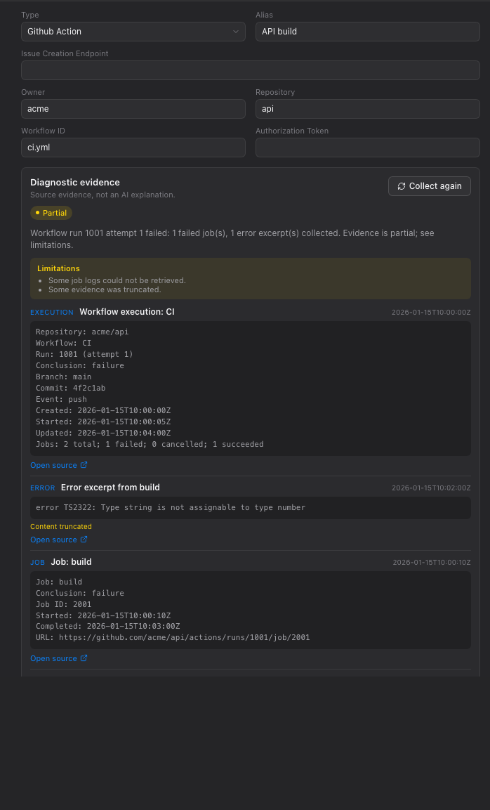

<p align="center">
  
</p>

<h1 align="center">One glance. Every build. Every alert.</h1>

<p align="center">
  <strong>Barklarm is a native build & observability radiator.</strong><br />
  It puts the status of your pipelines, monitors and alerts in your menu bar, so you can stop
  tab-hopping and see what broke from across the room.
</p>

<p align="center">
  <a href="https://github.com/alvarolorentedev/barklarm-app/releases/latest"></a>
  <a href="https://www.barklarm.com/"></a>
  <a href="https://www.barklarm.com/docs/intro"></a>
</p>

<p align="center">
  <a href="https://github.com/alvarolorentedev/barklarm-app/actions/workflows/ci.yml"></a>
  <a href="https://github.com/alvarolorentedev/barklarm-app/releases/latest"></a>
  <a href="https://github.com/alvarolorentedev/barklarm-app/releases"></a>
  <a href="https://github.com/alvarolorentedev/barklarm-app/stargazers"></a>
  
  
</p>

<p align="center">
  <a href="docs/media/barklarm-promo.mp4">
    
  </a>
</p>

<p align="center"><sub>▶ <a href="docs/media/barklarm-promo.mp4">Watch the 25-second tour</a></sub></p>

---

## Why Barklarm?

**Reduce cognitive load.** Your CI, monitors and logs already tell you what is happening — in ten different tabs. Barklarm brings them into one calm list and one menu bar icon.

**Know before your users do.** Green means good. Red means act. Native notifications and a tray menu put the failure in front of you without another dashboard to watch.

**Native, local, yours.** A Tauri app with a Rust shell and a TypeScript core. Your configuration stays on your machine. No account, no server, no notification plumbing to build.

**Know what failed, not just that it failed.** Opt in to diagnostic evidence for supported failures and inspect failed
GitHub Actions jobs, steps and bounded error excerpts without leaving Barklarm. Evidence is sanitized, kept in memory
and never sent to an AI service.

## How it works

1. **Add your sources.** Pick an integration or drop in a link. Set an alias so `api — production` reads like a human wrote it.
2. **Let it run.** Barklarm checks every source on your refresh interval and keeps the tray icon in sync.
3. **Get on with your day.** Glance at the menu bar. Open the failing build. Barklarm can even open an issue for you.

## Works with your stack

| Build & CI | Monitoring & alerts |
| --- | --- |
| [GitHub Actions](https://www.barklarm.com/docs/configuration) | [Datadog](https://www.barklarm.com/docs/configuration) |
| [Azure DevOps](https://www.barklarm.com/docs/configuration) | [Sentry](https://www.barklarm.com/docs/configuration) |
| [Bitbucket Pipelines](https://www.barklarm.com/docs/configuration) | [New Relic](https://www.barklarm.com/docs/configuration) |
| [CCTray](https://www.barklarm.com/docs/configuration) (Jenkins, TeamCity, …) | [Opsgenie](https://www.barklarm.com/docs/configuration) |
| | [Grafana](https://www.barklarm.com/docs/configuration) (alpha) |
| | [Graylog](https://www.barklarm.com/docs/configuration) |

CCTray support covers any server that exposes a `cc.xml` feed, so tools like Jenkins, TeamCity and other CCTray-compatible servers work without a Barklarm-specific plugin.

## See it in action

<p align="center">
  
</p>

<details>
  <summary><strong>More screenshots</strong> — configuration, diagnostics and settings</summary>
  <br />
  <p align="center">
    
  </p>
  <p align="center">
    
  </p>
  <p align="center">
    
  </p>
  <p align="center">
    
  </p>
</details>

## Install

**macOS (Homebrew)**

```sh
brew tap alvarolorentedev/tap
brew trust --tap alvarolorentedev/tap   # Homebrew 7+
brew install --cask alvarolorentedev/tap/barklarm
```

**Everyone else**

Download the installer for your platform from the [latest release](https://github.com/alvarolorentedev/barklarm-app/releases/latest):

- **macOS** — `.dmg` (Apple Silicon or Intel)
- **Windows** — `.exe` installer or `.msi`
- **Linux** — `.deb`, `.rpm` or `.AppImage`

Barklarm starts in the system tray. Choose **Configure** from the tray menu to open the settings window; closing it leaves Barklarm running in the background.

## Pricing

**Free. Not “free tier” free. Free.**

Unlimited observers, unlimited integrations, no account and no upsell. Barklarm is open source and built in the open.

If it saves you a bad morning, you can [sponsor the project](https://github.com/sponsors/alvarolorentedev) or leave a star.

## Loved by developers

> Want to stay ahead of the curve? @BarkLarm keeps me informed about system issues before they become major headaches.
>
> — **Abel Fernandez** ([@daferpi](https://twitter.com/daferpi))

> Want to know the secret to reducing mean time to detect and mean time to resolve? It starts with having a clear view of your system's alarms!
>
> — **Cris Moreiras** ([@CrisMoreiras](https://twitter.com/CrisMoreiras))

> @BarkLarm supports multiple data sources and integrations. Whether it's logs, metrics, or builds — I can connect them all in one place.
>
> — **Kevin Mas Ruiz** ([@kmruiz](https://twitter.com/kmruiz))

## Development

Barklarm uses [Tauri](https://tauri.app) as a thin native shell and keeps the observers, polling and state management in a platform-neutral TypeScript core. The core lives in `src/core` and `src/extensions`; it has no Tauri or Electron imports, so the same code can be reused by future clients. The desktop UI is React, and the Rust shell only handles the window, app lifecycle and config storage.

You need [Bun](https://bun.sh) 1.4+ and the [Rust toolchain](https://rustup.rs).

```sh
bun install
bun run dev        # native Tauri app; opens the settings window
bun run dev:mock   # real React app in a browser with deterministic data
bun run check      # format, lint, types, tests, coverage, renderer build
bun run test:e2e   # Playwright acceptance tests against the mock runtime
bun run build      # Tauri app and dmg, output in src-tauri/target/release/bundle/
```

Browser development needs no credentials, native dependencies or external services. Mock scenarios are selected with `?scenario=empty|healthy|failed-builds|running-builds|unavailable|multiple-failures|persistence|diagnostics-complete|diagnostics-partial|diagnostics-unavailable|diagnostics-multiple|diagnostics-unsupported|diagnostics-disabled|diagnostics-collecting|diagnostics-secrets`.

Development builds show the settings window immediately so the UI can be inspected. Production builds start in the tray.

See [AGENTS.md](AGENTS.md) for the repository guide, [CONTRIBUTING.md](CONTRIBUTING.md) for the contribution flow and [docs/engineering/DEVELOPMENT.md](docs/engineering/DEVELOPMENT.md) for detailed commands.

The promo video is a separate Remotion project:

```sh
cd promo
bun install
bun run studio    # preview scenes
bun run check     # verify promo assets
bun run render    # render out/barklarm-promo.mp4
```

## Support the project

<p>
  <a href="https://www.producthunt.com/posts/barklarm"></a>
  <a href="https://alternativeto.net/software/barklarm/about/"></a>
  <a href="https://github.com/sponsors/alvarolorentedev"></a>
</p>

- Website: [barklarm.com](https://www.barklarm.com/)
- Docs: [barklarm.com/docs/intro](https://www.barklarm.com/docs/intro)
- Issues and ideas: [GitHub Issues](https://github.com/alvarolorentedev/barklarm-app/issues)
- Follow along: [@barklarm](https://twitter.com/barklarm)

## Contributors ✨

Thanks goes to these wonderful people ([emoji key](https://allcontributors.org/docs/en/emoji-key)):

<!-- ALL-CONTRIBUTORS-LIST:START - Do not remove or modify this section -->
<!-- prettier-ignore-start -->
<!-- markdownlint-disable -->
<table>
  <tbody>
    <tr>
      <td align="center" valign="top" width="14.28%"><a href="https://github.com/pehota"><br /><sub><b>Dimitar Apostolov</b></sub></a><br /><a href="https://github.com/alvarolorentedev/barklarm-app/commits?author=pehota" title="Code">💻</a></td>
      <td align="center" valign="top" width="14.28%"><a href="https://github.com/ezinneanne"><br /><sub><b>Ezinne Anne Emilia</b></sub></a><br /><a href="https://github.com/alvarolorentedev/barklarm-app/commits?author=ezinneanne" title="Documentation">📖</a></td>
      <td align="center" valign="top" width="14.28%"><a href="https://github.com/sergitorrres"><br /><sub><b>Sergi Torres</b></sub></a><br /><a href="https://github.com/alvarolorentedev/barklarm-app/commits?author=sergitorrres" title="Code">💻</a></td>
      <td align="center" valign="top" width="14.28%"><a href="https://github.com/skreis"><br /><sub><b>Steve Kreis</b></sub></a><br /><a href="https://github.com/alvarolorentedev/barklarm-app/commits?author=skreis" title="Documentation">📖</a></td>
    </tr>
  </tbody>
</table>

<!-- markdownlint-restore -->
<!-- prettier-ignore-end -->

<!-- ALL-CONTRIBUTORS-LIST:END -->

This project follows the [all-contributors](https://github.com/all-contributors/all-contributors) specification. Contributions of any kind are welcome!

## License

[MIT](https://opensource.org/licenses/MIT)
